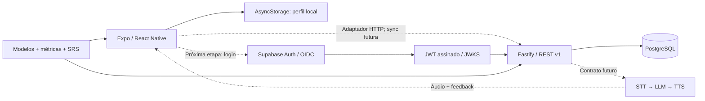

# Arquitetura e decisões

## Visão do produto

Monorepo com um monólito modular na API e um aplicativo organizado por funcionalidades. Isso evita infraestrutura de microsserviços antes de validar conteúdo e retenção. `Language` é uma chave de domínio explícita em toda operação de estudo. Trocar o tema não migra, soma nem apaga registros de outra língua.



Linhas pontilhadas representam integrações planejadas. No MVP, o front-end funciona localmente e a API é validada separadamente.

## Fronteiras

| Módulo      | Responsabilidade                                                           | Implementação atual                                   |
| ----------- | -------------------------------------------------------------------------- | ----------------------------------------------------- |
| Dashboard   | Histórico semanal, minutos totais, conclusões distintas, streak por língua | Mobile + métricas compartilhadas + endpoint protegido |
| Currículo   | Meses/semanas, input, produção oral                                        | Roteiro 26 semanas e 3 lições piloto                  |
| Estudo      | Tempo ativo, pausa, conclusão, idempotência                                | Timer mobile e transação na API                       |
| Caderno     | Criar/editar/excluir notas isoladas                                        | Local + CRUD API; sem sync automática                 |
| Revisão     | Agendamento após recuperação ativa                                         | SM-2 simplificado + schema; fila/UI futuras           |
| Conversação | Cenários, áudio, feedback formativo                                        | Roteiro TTS; integração de IA futura                  |
| Identidade  | Perfil local / autenticação em nuvem                                       | Local no mobile; verificador JWKS na API              |

## Fluxos e invariantes

**Abrir lição:** captura UUID, idioma, ID da lição e instante inicial. Timer usa diferenças de timestamps, não incrementos de `setInterval` (que podem atrasar). AppState pausa em segundo plano; pausa manual continua após voltar ao app. Ao sair ou concluir, soma segundos ativos e atualiza o histórico local. Uma lição concluída repetida acrescenta tempo, mas não aumenta a contagem de lições distintas. Sessões menores que um segundo não são registradas.

**Persistência:** carga é validada antes de usar; escritas são serializadas para impedir que um snapshot antigo sobrescreva outro. Notas só mudam depois de confirmar Salvar. O editor captura o idioma ao abrir. Nenhuma credencial é persistida em AsyncStorage. Uma falha de leitura preserva os dados existentes. Para produção, adicionar armazenamento seguro para tokens, isolamento por conta e exportação/backup de notas.

**Tempo e confiança:** contagem local melhora a experiência, mas não prova que alguém estudou. API valida duração, idioma/ lição, futuro tolerado em até 2 min e máximo de 6 h ativas por sessão. Missões são de motivação pessoal; recompensas com valor econômico exigiriam validação server-side adicional.

**Sync futura:** após login, criar namespace por `userId`; nunca enviar histórico de um perfil a outra conta silenciosamente. Enfileirar sessões imutáveis pelo UUID; reenvio aceita o mesmo payload e rejeita alterações com 409. Notas precisam de versão/revision e resolução explícita de conflitos antes de habilitar edições multi-dispositivo. O endpoint atual de notas usa última escrita recebida, adequado ao protótipo de um cliente; não oferece merge de edição concorrente. Retentar falhas transitórias com backoff, manter cópia local e mostrar status.

**Proficiência:** apenas uma avaliação pode atualizar `user_languages.proficiency` e criar `proficiency_assessments`. Sem rota de avaliação nesta etapa. Tempo e conclusão medem constância, não domínio da língua.

## Contrato REST

| Método e rota               | Autenticação | Comportamento                                        |
| --------------------------- | ------------ | ---------------------------------------------------- |
| GET `/health`               | Pública      | Executa consulta ao banco; 200 `{status:"ok"}`       |
| GET `/v1/catalog`           | Pública      | Conteúdo publicado e `pilot:true`                    |
| PATCH `/v1/profile`         | Bearer JWT   | `{timezone:"America/Sao_Paulo"}`; fuso IANA validado |
| GET `/v1/dashboard`         | Bearer JWT   | Três perfis, métricas e sessões do usuário           |
| POST `/v1/study-sessions`   | Bearer JWT   | 201 ao criar; 200 mesmo UUID/payload; 409 conflito   |
| GET `/v1/notes?language=ko` | Bearer JWT   | Somente notas do usuário e idioma                    |
| PUT `/v1/notes/:uuid`       | Bearer JWT   | `{language,body}`; cria/atualiza nota própria        |
| DELETE `/v1/notes/:uuid`    | Bearer JWT   | 204; não altera nota de outro usuário                |
| POST `/v1/conversations`    | Bearer JWT   | 501, provedor ainda não conectado                    |

Exemplo de sessão:

```json
{
  "id": "240d9fc8-a42e-4361-8b4b-3b10cc779072",
  "language": "ko",
  "lessonId": "ko-w1-intro",
  "startedAt": "2026-10-11T13:00:00.000Z",
  "endedAt": "2026-10-11T13:12:00.000Z",
  "activeSeconds": 600,
  "completed": true
}
```

`userId` é obtido exclusivamente do JWT verificado. Não é aceito no body. O banco cria os três perfis no primeiro acesso autenticado. No deploy, o servidor usa uma role com privilégios mínimos; não exponha as tabelas diretamente por uma API pública sem RLS. Este schema é destinado a acesso pela API Fastify, que filtra por proprietário. Rate limit básico de 120 requisições/minuto/IP, limite de body de 128 KB e CORS por origem explícita; ajustar por usuário e por custo ao integrar IA.

## Conversação por IA — próxima etapa

1. Solicitar consentimento e permissão de microfone; permitir alternativa em texto.
2. Enviar áudio curto para STT pelo servidor, com limite de duração/tamanho e exclusão de temporários.
3. Selecionar cenário, idioma, repertório conhecido e dificuldade. O LLM responde com frases curtas e fornece reformulação útil sem interromper cada fala.
4. Sintetizar áudio por TTS, devolver texto/áudio e feedback de compreensão. STT isolado não mede precisão fonética; pontuação de pronúncia requer modelo apropriado e validação pedagógica.
5. Aplicar cotas por usuário, timeouts, cancelamento, moderação contextual, orçamento e observabilidade. Áudio/transcrição não são armazenados por padrão.

Escolher provedor após medir vozes coreanas/japonesas/francesas, latência, custo e políticas de dados. Segredos só no servidor/gerenciador de segredos. Não há necessidade de chave de IA para o MVP atual.

## Produção e evolução

API em container Node 22+, TLS no ingress e PostgreSQL gerenciado com migrations antes do rollout. Supabase Auth é a opção preferida, usando chaves assimétricas compatíveis com JWKS. Acrescentar logs estruturados com request IDs e redaction de Authorization; métricas de erro, custo/latência de voz, backups e ensaio de restauração. O dashboard atual consulta o histórico completo por perfil; em escala, paginar histórico e agregar por dia no banco/materialized views. Testes de integração usam fixtures de autenticação apenas no processo de teste; um login OIDC real requer validação na etapa seguinte.

Prioridades: (1) login/secure storage/sync e recuperação de sessão, (2) conteúdos revisados e fila SRS com APIs transacionais, (3) avaliação oral + IA por voz, (4) animações/assets 3D otimizados e testes de acessibilidade em aparelhos reais.
