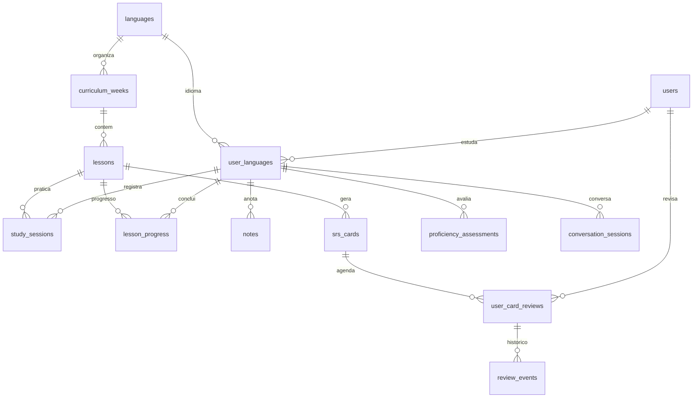

# Modelo de dados

PostgreSQL 17, UUID para identidade, UTC para instantes e fuso IANA no perfil para metas diárias. `ko`, `ja`, `fr` são códigos estáveis. [001_initial.sql](../database/001_initial.sql) é a fonte executável; [migrate.ts](../apps/api/src/migrate.ts) aplica e popula o planejamento.

`review_events` referencia usuário e cartão diretamente; o par identifica a agenda, sem FK composta para permitir histórico independente.

| Tabela                  | Chave / principais dados                                                                    | Invariante                                                                  |
| ----------------------- | ------------------------------------------------------------------------------------------- | --------------------------------------------------------------------------- |
| users                   | PK `id`, display_name, timezone                                                             | ID corresponde ao `sub` UUID do emissor de auth                             |
| languages               | PK `code`, name, locale                                                                     | Apenas ko/ja/fr                                                             |
| user_languages          | PK `(user_id,language_code)`, daily_goal_minutes, proficiency, assessed_at                  | Progresso independente; nível A0 inicial                                    |
| curriculum_weeks        | PK `(language_code,week)`, month, theme, oral_goal                                          | 26 semanas de planejamento por idioma                                       |
| lessons                 | PK `id`, language_code, week, content JSONB, status                                         | FK de semana/língua; publicação é explícita                                 |
| study_sessions          | PK `id`, user_id, language_code, lesson_id, started_at, ended_at, active_seconds, completed | Tempo positivo, ≤ duração e ≤ 6 h; FK composta impede lição de outra língua |
| lesson_progress         | PK `(user_id,lesson_id)`, language_code, completed_at, attempts                             | Uma conclusão distinta, várias tentativas                                   |
| notes                   | PK `id`, user_id, language_code, body, updated_at                                           | Texto 1–20.000 caracteres; proprietário fixo                                |
| srs_cards               | PK `id`, language_code, lesson_id, front/back                                               | Cartão ligado à língua da lição                                             |
| user_card_reviews       | PK `(user_id,card_id)`, ease, interval_days, repetitions, due_at                            | Estado de agendamento por aluno/cartão                                      |
| review_events           | PK `id`, user_id, card_id, quality 0–5, reviewed_at                                         | Histórico para medir recuperação, não só exposição                          |
| proficiency_assessments | PK `id`, user_id, language_code, level, rubric JSONB                                        | Rubrica/instante justificam a mudança de nível                              |
| conversation_sessions   | PK `id`, user_id, language_code, scenario, feedback JSONB                                   | Sem gravação/transcrição permanente por padrão                              |

Notas e sessões têm índices por proprietário/idioma/data; SRS tem índice por usuário/vencimento. Migrations usam checksum e advisory lock para evitar duas aplicações concorrentes. Sessão e atualização de conclusão acontecem na mesma transação. Sessões repetidas pelo UUID não incrementam tentativas.

## Cálculos do dashboard

- Tempo por língua: `SUM(active_seconds)` das próprias sessões.
- Conclusões: lições distintas com `completed = true`; espelhadas transacionalmente em `lesson_progress`.
- Evolução semanal: minutos empilhados por língua e dia local de encerramento da sessão.
- Streak: sequência de dias com ao menos uma sessão ativa de 60 s no idioma; hoje sem prática mantém a sequência de ontem até o final do dia.
- Missões: 20 min acumulados + ao menos uma prática concluída hoje, no idioma selecionado.
- Proficiência: nível mais recente avaliado; nenhuma conversão automática de minutos para CEFR.

No protótipo, uma sessão cruzando a meia-noite é atribuída ao dia em que termina. Para apuração rigorosa, uma evolução deve registrar segmentos ativos e dividi-los nas fronteiras de dia do perfil.

## Armazenamento local

Chave `lingua.local.v1` com `{version,selected,sessions[],notes[]}`. Cada nota/sessão possui sua própria `language`; trocar a seleção altera apenas a ambientação e o filtro. Não há conta remota nem sincronização automática nesta versão. Uma futura migração precisa separar namespaces por usuário, permitir exportação e registrar conflito de notas; os UUIDs de sessão podem ser reutilizados para reenvio idempotente.
